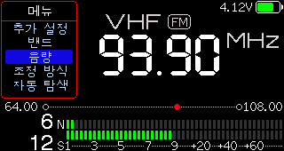
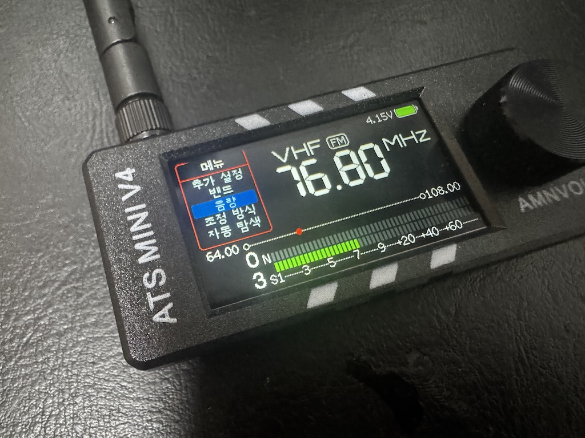

# ATS Mini KR UI

**ATS Mini를 한국어 메뉴로 쓰기 위한 ESP32-S3 / SI4732 수신기 펌웨어**입니다. [hakjong/ats-mini-kr](https://github.com/hakjong/ats-mini-kr)의 v2.40 기반 코드에서 이어받아, 한글 메뉴를 추가했습니다.

[펌웨어 다운로드](https://github.com/jh78bb/ats-mini-kr-ui/releases/latest) · [변경 기록](CHANGELOG.md) · [사용 설명서](docs/source/manual.md)

[AI 에이전트로 설치하기](#ai-에이전트로-설치하기)





## v2.41에서 달라진 점

- 언어 설정이 없으면 **한국어(KR)** 메뉴로 시작합니다. **설정 → 언어 → EN**에서 영어로 바꿀 수 있고, 선택한 언어는 재부팅 후에도 유지됩니다.
- 메인 메뉴, 설정, 수신 지역 목록을 한글로 표시합니다. FM·AM·USB·LSB·RDS 같은 무선 약어는 그대로 표시합니다.
- 한국 FM 방송국명은 메뉴 언어와 관계없이 한글로 표시하며, 긴 이름은 화면 폭에 맞춥니다.
- 한국 FM 지역 추론, 방송 목록·ATS·ETM, 즐겨찾기, 주간·야간 단파 밴드, 웹에서 저장 주파수 백업·복원 등 기존 기능을 이어받았습니다.

## 내 기기에 맞는 파일

| 기기 | 릴리스 파일 | 확인 범위 |
| --- | --- | --- |
| 표준 ATS Mini + OSPI PSRAM | `ats-mini-v2.41-ospi.zip` | AMNVOLT ATS Mini V4에서 한글 UI 검증. Flash 16MB, PSRAM 8MB |
| 표준 ATS Mini + QSPI PSRAM | `ats-mini-v2.41-qspi.zip` | 빌드 제공. 실기 미검증 |
| LILYGO T-Embed SI4732 | `ats-mini-v2.41-lilygo-t-embed.zip` | 전용 빌드 제공. 실기 미검증 |

표준 빌드는 Flash 8MB 이상을 사용합니다. 판매명에 붙은 V3·V4보다 **보드 종류와 PSRAM 방식**을 기준으로 선택하세요. [보드와 PSRAM 확인 방법](https://esp32-si4732.github.io/ats-mini/flash.html#firmware-files)

## 설치

1. USB 데이터 케이블로 라디오를 연결하고 [기존 펌웨어와 설정을 백업](docs/source/recovery.md#backup)합니다.
2. [Releases](https://github.com/jh78bb/ats-mini-kr-ui/releases/latest)에서 기기에 맞는 ZIP을 내려받아 압축을 풉니다.
3. 처음 설치할 때는 [USB 설치 안내](docs/source/flash.md#flash-using-a-web-browser)에 따라 기록합니다. `ats-mini.ino.merged.bin` 하나를 주소 `0x0`에 기록하면 설정이 초기화됩니다. 호환되는 설정을 보존하려면 [개별 파일 네 개를 기록하는 방법](docs/source/flash.md#firmware-files)을 참고하세요.
4. 재부팅한 뒤 **설정 → 기기 정보**에서 버전을 확인합니다. 다이얼을 돌리면 시스템 정보 페이지에서 PSRAM 용량도 볼 수 있습니다.

Wi-Fi 수동 업데이트를 지원하고 파티션 구성이 호환되는 펌웨어에서는 웹 인터페이스의 **Update**에 기종별 `-ota.bin`을 올릴 수 있습니다. [Wi-Fi 업데이트 안내](docs/source/flash.md#update-over-wi-fi)

## AI 에이전트로 설치하기

라디오 전원을 켜고 USB 데이터 케이블로 컴퓨터에 연결하세요. **이 컴퓨터의 터미널과 USB 시리얼 포트에 접근할 수 있는 AI 에이전트**에 아래 프롬프트를 붙여 넣으면 됩니다. 모델명과 현재 버전을 알고 있으면 함께 적으세요. USB 접근이 없는 환경이라면 위의 수동 설치 절차를 이용하세요.

```text
USB로 연결한 ATS Mini에 ATS Mini KR UI의 최신 정식 릴리스를 설치해 줘.
https://github.com/jh78bb/ats-mini-kr-ui/releases/latest

1. 연결된 USB 시리얼 포트가 내 라디오인지 확인해 줘. 보드 종류, ESP32-S3,
   Flash 용량, PSRAM 방식(OSPI 또는 QSPI)을 확인하고, 불확실하면 내게
   모델명이나 설정 → 기기 정보 화면을 물어봐. V3·V4 이름만으로 추정하지 마.
2. 위 GitHub 릴리스에서 기기에 맞는 OSPI·QSPI·LILYGO ZIP을 받아 줘.
   배포 파일을 사용하고, 릴리스가 SHA-256을 제공하면 일치하는지 확인해 줘.
3. 쓰기 전에 esptool로 현재 플래시 전체를 로컬 파일에 백업해 줘.
   백업 파일 크기가 감지된 Flash 용량과 일치하는지 확인하고 경로를 알려줘.
4. ZIP에 든 파일을 사용해 프로젝트의 USB 설치 안내에 따라 기록해 줘.
   기존 설정과 방송 목록을 보존할 수 있는지 먼저 확인하고, 호환성을
   확인할 수 없거나 초기화가 필요하면 쓰기 전에 이유를 알려주고 물어봐.
   https://github.com/jh78bb/ats-mini-kr-ui/blob/main/docs/source/flash.md
5. 쓰기 검증과 재부팅 후 버전, PSRAM 인식, 한글 메뉴를 확인해 줘.
   화면을 직접 읽을 수 없으면 내가 설정 → 기기 정보에서 볼 항목을 알려줘.
   설치한 버전과 사용한 파일, 백업 경로, 확인한 항목을 한국어로 정리해 줘.
```

## 한국 FM 방송국명 사용하기

**설정 → FM 지역 → KR**로 설정한 뒤 **설정 → 수신 지역**에서 직접 지역을 선택하거나 **자동**을 사용하세요. 자동은 **방송 목록 → ATS**로 찾은 FM 주파수를 바탕으로 지역을 추론합니다. 지역을 구분하기 어렵거나 여러 방송국이 주파수를 공유하면 이름이 생략될 수 있습니다. 수신된 RDS 방송국명이 있으면 우선 표시합니다.

## 출처와 라이선스

이 저장소는 [hakjong/ats-mini-kr](https://github.com/hakjong/ats-mini-kr)의 포크이며, 원 프로젝트는 [esp32-si4732/ats-mini](https://github.com/esp32-si4732/ats-mini)입니다. 원 프로젝트의 [하드웨어 문서](https://esp32-si4732.github.io/ats-mini/hardware.html)와 이 포크의 [개발 문서](docs/source/development.md)를 참고할 수 있습니다. 코드는 [MIT 라이선스](LICENSE)로 배포합니다.
